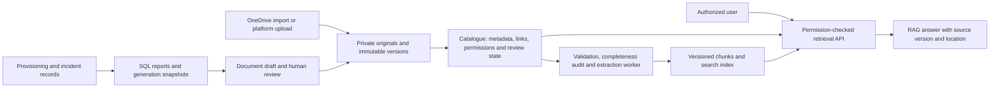

# Document storage, RAG and FTTH lifecycle investigation

Reviewed 2026-10-09 against the complete six-page v1 PDF, the complete v2 DOCX,
and the current feature branch. This is a proposed design and gap investigation,
not a claim that these capabilities are implemented.

The user confirmed that a colleague owns the RAG proof of concept and document
completeness audit tool; neither has been supplied. Integrate them through an
explicit contract when available. The MTN customer handover template is also
pending. Storage, record linking and lifecycle reporting can proceed beforehand;
the approved template layout and required fields must wait for that template.

## Requirements traced to the documents

| Reference | Requirement | Current gap |
| --- | --- | --- |
| v1 pp. 2–4, objectives 1–2 | Central organization of acceptance/customer handovers, shift handovers, activity logs, work orders, RCA and daily/weekly WRF reports; traceable retrieval | No document catalogue, version registry, ingest/index pipeline or knowledge search |
| v1 pp. 3–4, objective 3; v2 objective 3 and phase 2 | FTTH request, scheduling, mobilization, installation, escalation and resolution; automatic incident links | Five provisioning stages exist; formal case escalations and order-to-incident links are missing |
| v2 sections 4, 6.1 and 7 | Existing OneDrive import followed by ongoing sync; completeness auditing before RAG indexing | No connector or completeness tool integrated; folder organization must not substitute for verified metadata |
| v2 objectives 2 and 6, phases 4–5 | Generated RCA, shift handover, work order, reports, service acceptance/handover and correspondence drafts reviewed before finalization | Existing acceptance PDF is not a reviewed/versioned MTN customer handover; report generation and reviewed document approval are missing |
| v2 section 8 | Department-specific access for NOC, Planning/Sales, WAN/Systems and administrators | Current Viewer/Operator/Admin roles are coarse; files lack document/entity/department ACLs |
| v1 pp. 5–6; v2 sections 11 and 14 | Installation counts, stage duration, escalation rate, incident-category MTTR, retrieval accuracy/adoption | Kanban column counts and service-outage MTTR exist; installation cohort reporting, structured stage durations, incident-category MTTR and RAG evaluation remain |
| v2 section 6.2 | Reconcile 514 historical incidents against the original workbook | Import script exists; no evidence of complete real-workbook reconciliation |
| v2 sections 12–13 | Database/document backups, retention, recovery and server capacity | Preview volumes persist locally; they are not off-host backups or a recovery drill |

Do not confuse customer service handover with shift handover. Both belong in the
catalogue, with distinct document types and approval rules.

## Findings in the current code

- `backend/app/api/routers/provisioning.py` saves four installation photos under
  `static/uploads/installations` and commits installation completion before PDF
  generation. A PDF failure is printed and the API still returns the completed
  order; there is no persisted generation failure/retry queue.
- `backend/app/services/pdf_generator.py` writes an acceptance PDF directly to
  `static/documents/acceptances`. Its filename includes customer-supplied values;
  repeated generation can reuse a name. There is no document ID, content checksum,
  immutable revision, template version, approval state or delivery record.
- `backend/app/templates/ftth_acceptance.html` has a single checklist Boolean
  driving multiple specific certifications. Item-level evidence and reviewer
  approval are needed before such assertions become a customer-facing document.
- The PDF is generated at `PENDING_ACCEPTANCE`, before NOC approval. Calling it
  final customer handover or proof of approved acceptance would be inaccurate.
- `compose.dev.yaml` persists `/app/static` in `preview_documents`. Authentication
  protects `/static`, but role-level authentication does not restrict each file
  to a relevant customer, department or authorized document reader.
- `ServiceOrder` holds completion and planned dates and an activated-service FK.
  It lacks explicit acceptance/mobilization/handover timestamps and dedicated
  structured stage transitions. Activity/audit records are useful history but
  are not yet a complete duration-reporting ledger.
- `activate_ftth` creates the customer/service and drop allocation. `isp=MTNN`
  remains on the order; the activated service type is simply `FTTH`, so reporting
  must join the order rather than guessing the provider from service type/name.
- FTTH Kanban counts currently show the number of loaded orders per current
  stage, not historical installation totals, acceptance totals or duration cohorts.
- Incidents support resolution details and the Response centre supports confirmed
  service outages. Manual incident intake does not provide an order/service link
  selector; there is no dedicated pre-activation installation-escalation flow.

## Storage architecture

Retain PostgreSQL/PostGIS for operational records and document metadata. Keep
large binary files in private storage. Put text chunks and optional embeddings in
a rebuildable search index. Do not use a vector index as the document archive or
as the source of installation/incident statistics.

For the first local slice use a protected filesystem volume behind a storage
interface. For the company server select a maintained private object-storage
implementation or approved managed company storage after capacity, support,
licensing and recovery review. The interface must support immutable writes,
checksum verification and authorized reads without depending on a vendor.
No additional cloud storage account is required by this proposal.



Storage keys use stable IDs rather than customer names or submitted paths:

```text
originals/{document_id}/{version_id}/source.{validated_extension}
derived/{version_id}/{extraction_run_id}/text.json
generated/{document_id}/{version_id}/handover.pdf
templates/{template_id}/{template_version_id}/source.docx
quarantine/{ingestion_job_id}/{object_id}
```

Human-facing collections may show `FTTH / MTNN / 2026 / FN659353 / Handover`,
`Incidents / TT-reference / RCA` or `Reports / Daily / date`. These are catalogue
views, not fragile physical paths. Store the original filename as metadata and
offer a safe readable download filename. Keep the original file, not just text.

OneDrive remains authoritative for existing imported documents until an approved
migration retires it. Platform-generated documents have platform-owned versions;
an optional publication to OneDrive is a tracked copy. Avoid two-way overwriting
and sync loops. Do not rename or rearrange company OneDrive folders during import.

## Proposed relational records and integrity

| Record | Purpose and important fields |
| --- | --- |
| `documents` | Stable identity, title, document type, owning department, classification, lifecycle, current approved version |
| `document_versions` | Document FK, revision, private storage key, SHA-256, verified MIME/size, original filename, author, created time, completeness/review/index states |
| `document_sources` | Source system, drive/item IDs, source version or eTag, source URL/path, modification time, sync checkpoint and deletion state |
| Typed document links | Separate FK-backed order, customer, service, incident and infrastructure link tables; one document can support several records |
| `document_permissions` | Read/review/manage grants for mapped users/groups/departments, explicit restrictions, source ACL provenance and last reconciliation time |
| `document_reviews` | Immutable reviewer decisions, comments, approved version/hash, actor and time |
| `document_templates` and template versions | Document type/provider, reviewed layout, required field schema, renderer version and template checksum |
| `document_generation_jobs` | Durable job/outbox, source snapshot/hash, template version, unique idempotency key, status, attempts and failure reason |
| `document_ingestion_jobs` | Validation/extraction/OCR/index checkpoints, retry count, error classification, source checksum and parser version |
| `document_chunks` | Version FK, section/page or sheet/row/cell location, text, chunk hash, extraction version and index state |
| `document_embeddings` | Chunk FK, embedding model/version/dimension and vector; parallel index versions for controlled rebuild |
| `document_deliveries` | Reviewed document version, recipient/channel, actual delivery attempt/reference and acknowledgment; separate from document approval |
| `rag_query_events` | Authorized query metrics, returned source version IDs, feedback and evaluation outcome; redact sensitive content in logs |

Unique `(document_id, revision)` and `(source_system, drive_id, item_id,
source_version)` prevent duplicate versions/source imports. Content hashes detect
identical bytes but do not merge permissions or unrelated customer identities.
An identical document imported under two access boundaries must not expose either
boundary through global deduplication. Use FK-backed link tables rather than an
unchecked `(entity_type, entity_id)` column.

Document approval pins a precise hash and version. Any changed content needs a
new review. The current approved version remains searchable while its replacement
is being processed; publish replacement chunks atomically. Lifecycle (draft,
approved, superseded, archived), ingest status and completeness are separate
fields. Preserve original evidence and corrections as new versions.

## Ingestion and format handling

1. Register a source item/upload and durable job. Enforce size/type limits,
   generated storage keys, path confinement and safe content-disposition.
2. Write to quarantine with checksum. Validate actual file content, scan for
   malware and reject unsafe archives, decompression bombs and executable macros.
   Parsing runs with resource/time limits, no network and restricted file access.
3. Run type-specific completeness checks: required identifiers, dates, evidence,
   document family, applicable template requirements and explicit reasons for
   missing fields. A readable file is not automatically a complete one.
4. Extract content and metadata with provenance. Suggested customer/service/TT/FN
   matches need confidence and review; never attach records by customer name alone.
5. Produce permission-scoped, versioned chunks. Index only approved eligible
   content under the default retrieval policy. Restricted draft review is a
   separate explicit mode; incomplete files remain discoverable in the catalogue
   with reasons but do not silently become trusted operational knowledge.
6. Save checkpoints and retry safely. Display missing references, unreadable files,
   quarantined items and sync lag; failed ingestion is never reported as complete.

| Format | Extraction and retrieval approach |
| --- | --- |
| Text PDF | Retain pages and table structure; citations identify document version and page |
| Scanned PDF/images | OCR with page/image and confidence; flag low-quality results for review; image existence is not proof of the assertion it illustrates |
| DOCX | Preserve headings, paragraphs, tables and section locations; retain original template/source |
| XLSX | Extract sheets, headers and row/cell coordinates; preserve identifier/phone columns as text; record formulas and cached-value freshness without executing macros/formulas |
| CSV | Record encoding/delimiter and header mapping; validate types while preserving leading zeros and source row numbers |
| Legacy XLS, encrypted or unsupported files | Quarantine or use a reviewed isolated converter; visible failures instead of silent omission |

Spreadsheet tables should be chunked with repeated headers and bounded row groups,
not split mid-row into arbitrary text. Operational workbook imports need a dry
run, mapped schema, source-row IDs, accepted/rejected counts, deduplication and
reconciliation. Preserve the original workbook as evidence. Installation counts
and incident MTTR use relational queries over validated data, not similarity
search or an LLM estimating totals from spreadsheet chunks.

OneDrive sync should support initial enumeration, persisted pagination/delta
checkpoints, updates/deletions, expired-checkpoint recovery and periodic permission
reconciliation. Delta sync alone must not be assumed to provide all effective
permissions. Choose Graph permissions supported by the intended endpoints and
approved resource scope; validate Selected permissions compatibility in staging.
Imported deletion/access revocation blocks retrieval promptly, including cached
answers, while retention of original bytes follows the agreed company policy.
Stale or unavailable source ACLs fail closed; source-reader access does not grant
all users access to indexed copies.

## RAG integration contract for the colleague's project

The platform owns document identity, storage, permissions, approval, jobs and
operational data. The colleague's audit tool returns structured validation
findings (required/missing fields, extraction quality, tool version and evidence).
Their RAG engine consumes authorized, versioned content and returns structured
answers with citations. Keep the integration behind an adapter; adding a directory
does not grant it unrestricted database/storage access or execute its code.

At handoff obtain its parser/model dependencies, API/input-output schema, supported
formats, embedding provider/dimensions, evaluation set, failure behavior and data
handling requirements. Use a separate worker environment if dependencies conflict
with the API. Do not ship company content to an external model until the company
approves its data handling and credentials are configured.

Recommended baseline: PostgreSQL full-text search for exact identifiers and terms,
with pgvector evaluated for semantic retrieval in the same database. Its extension
is not installed/configured in this milestone. Begin with exact search on modest
datasets; benchmark filtered recall/latency before choosing approximate indexes.
Use exact FN/TT/service lookup and structured SQL tools for operational questions.

Apply authorization to retrieval candidates and recheck every chunk/source before
it enters model context. Downloads enforce the same permissions. Document access
must be at least as restrictive as both its source and linked sensitive entities.
Cache entries include permission scope/version and are invalidated on revocation.
Treat document text as evidence, never as instructions to change permissions,
execute tools or send messages. Conflicting/stale sources are identified; an answer
without adequate evidence says the information is unavailable.

Example citation: `MTN handover — FN659353, revision 2, page 3`, opening that exact
authorized version. Evaluation covers exact references, Excel totals, recurring
faults, obsolete revisions, missing evidence, restricted documents, revoked access
and prompt injection, as well as retrieval latency and useful staff feedback.

## Proposed RAG interface

Use a dedicated **Knowledge** workspace with a conversation panel and a source
panel. Users can search/ask across approved knowledge, filter document types,
open exact authorized versions/pages/sheets, inspect conflicting evidence and
review generated RCA/handover/report drafts. The existing **Documents** page
continues to manage uploads, metadata and revision history.

Also expose a collapsible **Ask about this case** drawer within incident, FTTH
and customer/service pages. It receives the current record ID as explicit scoped
context and combines authorized operational facts with approved related sources.
Preserve the active case/timeline while the drawer is open. No fixed floating
overlay is needed to replace the operating console.

The assistant shows scope, source freshness and exact citations beside its
answer. No adequate evidence means an explicit unavailable/uncertain result.
Generated documents are drafts with factual fields from structured records;
approval, signatures and message delivery remain separate actions. Conversation
history requires scoped access, controlled retention and revocation behavior;
do not expose another department's context through saved sessions or caches.

For example, on an FTTH case: “Which earlier RCA describes this NAP fault?” or
“What is missing before acceptance?” In Knowledge: “Find the approved handover
for this FN” or “Draft a weekly report from the selected reporting window.”
Exact totals use authorized SQL reporting, not estimated sums from retrieved text.

This interface is a proposal, not a working RAG chat. Implement the integration
adapter and evidence/citation behavior with the colleague's tools before showing
an enabled AI conversation. Until then, file management, operational reporting
and manual triage remain usable independently.

## MTN handover lifecycle

Retain installation acceptance and customer handover as distinct document types.
Proposed sequence: installation evidence recorded → NOC technical acceptance →
approved-template handover draft → staff review/approval → final immutable version
→ separately tracked delivery/customer receipt. Confirm the template's actual
sign-off rules when supplied; do not invent signatures or customer acknowledgment.

NOC acceptance should enqueue a generation job in the same database transaction
as the activation/acceptance event. The worker uses a snapshot of order, customer,
service, infrastructure IDs/codes, observed test results, individual checklist
responses and authorized photos. Pin template and renderer versions; use
`(order_id, document_type, template_version, snapshot_hash)` for idempotency.
Generation failure leaves the accepted installation intact with a visible pending
or failed document job and a retry action. Handover delivery is not implied by
activation, a successful render or document approval.

Fields and final layout remain subject to the supplied MTN template. Record
FN/work-order/order/service IDs, provider and provenance now. Do not invent ONT
serials, optical readings, certifications or missing timestamps. Deterministic
template rendering fills factual fields; RAG can help draft narrative text from
approved sources but cannot fabricate mandatory fields or sign-offs.

## Installation statistics and stage history

Add append-only `ftth_stage_events` with order FK, old/new stage, event type,
server-recorded/effective times, actor, reason and provenance. Capture explicit
mobilization, completion and acceptance events; record holds, rescheduling,
cancellation and rework without deleting history. Historic effective times need
source evidence and a reviewed backfill; record missing dates as unknown.

Keep escalation as a linked parallel issue/hold, rather than losing an order's
current installation stage when it is escalated. Define which holds pause an
installation target; no timer pause is inferred from free-text notes.

| Metric | Definition |
| --- | --- |
| Requests received | Distinct FTTH orders created within the window |
| Total installations completed | Distinct orders with a verified first completion event in the window, not all requests or active services |
| NOC accepted installations | Distinct orders with an actual NOC acceptance event in the window |
| Current backlog | Current non-terminal orders by stage, separate from period event counts |
| Handover ready/delivered/outstanding | Explicit approved-version and actual delivery states for eligible accepted orders |
| Stage duration | Time between explicit stage events, showing open-stage age and documented pauses; mean and median with sample size |
| Installation case duration | Defined scheduled-to-accepted cohort; repeat/rework duration shown separately |
| Escalation rate | Distinct escalated cases / distinct eligible cases in the same stated cohort; zero denominator yields unavailable |

Filter by provider (`MTNN`), FTTH category, date window, area, technician and stage.
Use WAT calendar boundaries converted to UTC, half-open time windows, explicit
cohorts and distinct order IDs. Do not count a re-render/retry as another install.
Show current lifetime totals separately from this week/month's event totals.
Existing `completion_date` can support provisional completed counts; acceptance
dates require validated audit history or new explicit events, not guessed dates.

## FTTH incidents, installation blockers and resolutions

Introduce FK-backed order–incident links with link type (installation blocker,
post-activation service fault or related evidence). One order can have several
incidents; one shared cable fault can affect many services/orders.

- Before activation: **Escalate installation** records a reason/severity/owner,
  creates or explicitly links a TT incident, preserves the installation stage,
  and attaches its order/evidence. Do not create a customer service outage for a
  customer who has not yet had an active service.
- After activation: **Report service fault** selects the existing FTTH service
  and customer, creates/links an incident and service ticket, then requires
  connectivity evidence before starting a confirmed outage interval.
- Existing shared faults should be selectable to prevent duplicate cable-cut
  incidents per customer. Dependency impact is a candidate set, not proof that
  every customer is down. Keep suspected and confirmed impact separate.
- The same response engine handles owner assignment, acknowledgment, escalation
  and drafts. Installation-blocker policies remain distinct from service SLA.
- Resolution requires action/root-cause/evidence and a recorded operator/time.
  Service restoration and incident closure remain separate; unresolved shared
  customers cannot disappear because one installation blocker was resolved.
- Expose customer/order/service timelines with incidents, technician actions,
  restoration, recurrence, RCA and linked documents. A recurring fault creates a
  new linked incident while preserving the previous resolved history.

Report FTTH incident volume, open/escalated/resolved counts, recurrence, category,
provider, area, owner and age. Label incident report-to-resolution MTTR separately
from confirmed service-outage MTTR. Supply numerator/sample size and duration
definition; records missing valid times are reported as missing, not zero.

## Implementation order and acceptance gates

1. **Private document foundation:** storage adapter, safe uploads, document/version
   catalogue, typed links, access checks, audit and visible background job state.
   Register existing installation photos/PDFs through an idempotent manifest;
   verify checksums and links before retiring old URLs. Download/read tests cover
   unauthorized records, filename traversal, duplicates and failed writes.
2. **FTTH lifecycle and reporting:** structured stage/acceptance events, provider
   filters, totals and cohort durations; pre/post-activation incident links and
   resolution evidence. Test counts against known timelines, retries, shared
   faults, held cases and rework. Do not wait for the handover template.
3. **Handover workflow:** generation outbox, review, version pinning and document
   readiness/delivery views. Add the supplied MTN template and required schema
   when available; test missing fields, generation retries and actual sign-off.
4. **Knowledge ingestion and retrieval:** local uploads and completeness adapter,
   colleague's RAG integration, citations/ACL checks and evaluated search; then
   initial OneDrive migration and ongoing sync when Graph access is granted.
5. **Generated operational documents and release:** reviewed RCA/work order/shift
   handover/report drafts; approved correspondence transport; permissions,
   retrieval evaluation, security review and database+document restore drill.

Back up originals, approved/generated versions, templates, metadata, permissions,
reviews and source manifests together. Indexes can be rebuilt; proof of origin
and approved hashes cannot. Agree retention/deletion/legal holds, RPO/RTO and
off-host ownership. Test restoration of a customer handover with its exact version,
permissions, source snapshot and linked FTTH/incident record, not only a database.

## Primary implementation references

- [Microsoft Graph driveItem delta](https://learn.microsoft.com/en-us/graph/api/driveitem-delta?view=graph-rest-1.0)
- [Microsoft Selected permissions and explicit resource grants](https://learn.microsoft.com/en-us/graph/permissions-selected-overview)
- [pgvector: exact search, filtering and approximate-index tradeoffs](https://github.com/pgvector/pgvector)
- [S3 object keys and metadata model](https://docs.aws.amazon.com/AmazonS3/latest/userguide/UsingMetadata.html)

These references inform the design; no connector, vector extension or object
storage service was installed as part of this investigation.
