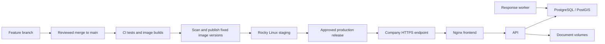

We have built a substantial **local NOC operating platform**, with connected provisioning, inventory, incident, reporting and document workflows. It is still a development preview: the live company integrations and several production controls remain unfinished.

I reviewed the current implementation and fetched the latest GitHub branch references. **There are currently no merge conflicts with `main`.** Details are below.

**1. What each page does**

The signed-in application has these routes:

| Page | Route | Main purpose |
|---|---|---|
| Operations overview | `/` | Current incidents and daily shift activity |
| Incident response | `/incidents` | Create, investigate and resolve incidents |
| Response centre | `/response` | Engineer ownership, escalation, outages, MTTR and communication review |
| Provisioning | `/provisioning` | Process FTTH installation requests |
| FTTH operations | `/ftth-operations` | Installation reporting and FTTH fault history |
| Customers & services | `/crm` | Customer records and enterprise service provisioning |
| Network topology | `/topology` | Geographic and logical infrastructure visualization |
| Monitoring | `/monitoring` | Sensor mapping and monitoring observations |
| Documents | `/documents` | Private files, revisions and record links |
| Knowledge assistant | `/knowledge` | Knowledge/source workspace awaiting RAG integration |
| Mail triage | `/mail` | Manual email classification and review preview |
| Audit history | `/audit` | Administrator view of recorded changes |

**Sign-in screen**

The application starts with an access screen.

- Locally, **Open local preview** uses an explicitly unverified development identity.
- Microsoft 365 sign-in and API token-validation code are implemented.
- Production requires Entra configuration and company role assignments.
- Protected production routes fail closed when authentication is unavailable or invalid.
- Roles currently distinguish **Viewer**, **Operator** and **Administrator**.

Live company sign-in has not been tested because the registration identifiers have not been supplied. Installer-specific and customer-specific access remain future work.

**Operations overview**

This is the daily operating screen for the NOC team.

It shows:

- Active incidents.
- Critical incidents.
- Incidents awaiting ownership.
- An incident queue ordered by severity and report time.
- Feed freshness, errors and manual refresh.
- A shared daily activity and shift-handover log.

The activity log supports:

- Tasks, incidents, customer escalations, maintenance, monitoring alerts and reminder entries.
- Person, shift, description, affected system, vendor reference and severity.
- Open, In Progress, Pending, Completed, Partially Closed and Aborted statuses.
- Maintenance schedules and reminder due times.
- Search and filters.
- Team summaries.
- Flagging work for the next shift and copying handover text.

Incident and customer-escalation activity entries create linked incident records. Provisioning actions also produce activity records.

**Remaining:** general activity attachments, richer RCA evidence, automated reminder delivery and generated handover documents. A “Reminder Email” entry currently records work; it does not send an email.

**Incident response**

This is the incident register and investigation workflow.

Staff can:

- Create incidents using the company trouble-ticket numbering convention.
- Categorize them as Fiber, Power, Technical, Maintenance or Other.
- Record severity, description, route/node references, responsible person and planned status.
- Search and filter by category, severity and status.
- Record resolution actions, team and root cause.
- Open the detailed response workspace.

The statuses include Open, In Progress, Pending, Resolved, Closed and Aborted.

**Remaining:** reconciliation of the historical incident workbook, fuller RCA/document workflows and broader reporting/export capabilities.

**Response centre**

This is the operational response engine. Its four main sections are:

| Section | What it does |
|---|---|
| Response queue | Shows engineer ownership, acknowledgment/restoration deadlines and escalation levels |
| MTTR & service targets | Reports verified outage durations, recorded downtime and target results |
| Notification drafts | Lets staff review prepared engineer/customer messages |
| Configuration | Lets administrators maintain engineers and versioned response policies |

Within **Manage response**, staff can:

- Assign an engineer.
- Acknowledge an incident using server-recorded time.
- Apply an appropriate response policy.
- Confirm affected customer services with evidence and outage start times.
- Record verified restoration times.
- Inspect the response timeline.

The background worker checks deadlines and records escalation events. Retry protection prevents duplicate escalation events and drafts.

Policy changes create new versions; existing incidents retain their selected version.

Reporting distinguishes:

- **Incident report-to-resolution duration.**
- **Confirmed service-outage MTTR.**
- **Recorded customer downtime**, with overlapping intervals merged.

An incident cannot be closed while its confirmed service outages remain open.

**Remaining:** agreed contractual targets, business-hours calendars, on-call rotation and actual notification delivery. Draft review is implemented; email/Teams delivery is not. Availability coverage is explicitly unverified.

**Provisioning**

This page moves FTTH requests through installation and NOC acceptance.

It supports table and Kanban views, manual requests and pasted WFM-style requests.

The paste workflow:

1. Paste the request.
2. Extract customer, address, package, phone, email, FN and work-order information.
3. Review the extracted fields.
4. Log the request.

Duplicate protection operates both in application logic and PostgreSQL constraints. Conflicting submissions are rejected instead of silently overwriting customer information.

The installation workflow is:

```text
Requested
   → Assign infrastructure and schedule
   → Installation in progress
   → Pending NOC acceptance
   → NOC accepted
```

Assignment supports:

- Existing or new NAPs.
- Splitter relationships.
- Available NAP ports.
- Existing or new drop cables.
- Installer and installation schedule.

Completion captures installation evidence, including the checklist, measurements and photos. The existing acceptance PDF flow remains available.

NOC acceptance creates the customer/service relationship and active drop allocation.

Kanban movement cannot bypass the underlying validation and evidence requirements.

**Remaining:** explicit holds, cancellation, rework, safe reservation release and the approved MTN customer handover document. The existing installation acceptance PDF is not the final customer handover.

**FTTH operations**

This page reports progress and manages FTTH case history.

It includes:

- Lifetime requests, completed installations and NOC acceptances.
- Reporting windows of 7, 30 or 90 days.
- Provider filters.
- Current backlog.
- Recorded stage visits and elapsed durations.
- Missing or partial historical evidence.
- Active and resolved FTTH incidents.
- Incident-category MTTR.

Each case has **History / incidents**.

Before activation, staff can create or link an **installation blocker**. An unresolved blocker prevents NOC acceptance.

After activation, staff can report a **service fault**. Shared faults can link to several customer cases without creating another incident for every customer.

Resolution requires recorded actions and root cause. Confirmed service outages must be restored separately.

**Remaining:** installation-specific target policies, pause/hold rules, cancellation/rework reporting, additional reporting dimensions and historical reconciliation.

**Customers & services**

This page currently lists customer records and provides working enterprise service provisioning.

Staff can:

- Select an existing customer or create a customer record.
- Provision DIA, dark fibre or Layer 2 services.
- Select compatible available primary cores.
- Allocate an optional backup core.
- Record bandwidth where applicable.

These allocations create the physical dependencies used by topology and impact analysis.

FTTH customer/service records are created through NOC acceptance in the FTTH workflow.

**Remaining:** a fuller customer profile, consolidated service/incident/document timelines, lifecycle editing and customer/service assistant context.

Provisioning records inventory allocation. It does not configure an OLT, ONT, router or switch, or prove connectivity.

**Network topology**

This has two complementary modes.

The **Geographic** view integrates FibreViz-style functionality:

- KMZ/KML import and persisted map records.
- Streets and satellite layers.
- Route search, filters and camera controls.
- Route/site popups, labels, symbols and legends.
- Cable styling, fibre-count tiers and status patterns.
- Recorded versus drawn lengths.
- Inventory-route mapping.
- Customer anchors and potential fault impact.
- Cable-specific impact inspection.
- Retractable route explorer and full-screen mode.

Imported geometry must be explicitly linked to inventory. A filename does not establish which cable or route it represents.

The **Logical** view shows:

- Routes, cables, PFPs, PFSs, NAPs and customer endpoints.
- Enterprise service types.
- Cable names, known core capacity and assigned core numbers.
- Expand/collapse behavior.
- Vertical and horizontal layouts.
- Search, dependency tracing and asset inspection.
- Recorded primary/backup relationships.

The infrastructure relationship is approximately:

```text
FTTH service → drop → NAP → PFS → PFP → core → cable → route

Enterprise service → primary/backup core allocation → cable → route
```

**Remaining:** wider inventory editing, multi-segment geometry, exact premises coordinates and verified redundancy/health.

Customer pins may use serving-NAP or route anchors. Potential cable-cut impact identifies customers to investigate; it does not confirm that all of them are down. Manual map annotations are browser preferences, not incident-resolution evidence.

**Monitoring**

This page links PRTG sensor identifiers to cables, routes or services.

It displays:

- Sensor mappings.
- Last observations.
- Processing outcomes.
- Linked incidents.
- Local **Preview Down / Preview Up** controls.

The backend supports authenticated monitoring-event intake, stable event IDs, duplicate protection and stale-event handling.

Mapped alarms can create incidents and affected-service tickets. An Up observation records alarm clearance; it does not automatically prove customer restoration or close the incident.

**Remaining:** the live PRTG bridge, cross-sensor correlation, flapping suppression, maintenance windows, freshness checks and producer retry monitoring.

**Documents**

This is the private document catalogue.

It supports:

- PDF, DOCX, XLSX, CSV, TXT, JPEG and PNG files.
- A 20 MB per-file limit.
- Document categories, titles and source/change notes.
- Order, service and incident links.
- Search, filtering and pagination.
- Immutable revisions.
- Original filenames, checksums, upload times and actors.
- Authenticated downloads with integrity checks.
- Owner/admin access and explicit NOC-wide sharing.

Files have generated storage paths rather than paths controlled by submitted filenames.

**Remaining:** malware scanning, approval, completeness checks, extraction, indexing, departmental permissions and retention automation.

Existing installation photos and acceptance PDFs have not yet been migrated into this catalogue. Their existing protected workflow remains available.

**Knowledge assistant**

The dedicated workspace provides a question panel and an authorized source catalogue.

It can currently:

- Search document titles.
- Inspect source metadata and latest revisions.
- Download an authorized original revision.
- Show the integration status.

The **bottom-right AI assistant** is also available across signed-in pages. It has:

- Chat and Sources tabs.
- Automatic context from an open incident or FTTH case.
- Record facts and directly linked documents.
- Suggested question prompts.
- Minimize and Escape behavior.
- A full-screen mobile layout.
- Topology full-screen support.

Questions are local drafts. They are cleared when the context changes or the panel closes.

**Remaining:** the actual RAG engine, approved-source ingestion, extraction, indexing, permission-filtered retrieval, citations, evaluated answers and reviewed document generation. Sending questions remains disabled.

**Mail triage**

This is a manual preview of the future NOC mailbox workflow.

Staff can paste message information and obtain explainable rule suggestions for:

- Outages.
- Customer escalation.
- Deadline/SLA risk.
- FTTH requests.
- Engineering actions.
- Restoration.
- Routine or uncertain messages.

The queue supports priority hints, review states, decision notes and links to existing incidents or FTTH orders.

Full pasted bodies are discarded after classification. Flagged/uncertain records retain a bounded excerpt; routine records retain no excerpt.

**Remaining:** Microsoft Graph connection, real mailbox synchronization, missed-message reconciliation, retention expiry, attachment/evidence preservation and evaluated automatic processing.

No mailbox is connected. This preview does not automatically create orders/incidents or send correspondence, and manual submission is disabled outside development preview.

**Audit history**

Administrators can inspect committed changes, including:

- Entity and action.
- Actor and verification status.
- Timestamp and request identifier.
- Restricted before/after snapshots.
- Older changes through pagination.

Audit events are recorded transactionally. Sensitive free text and contact information are excluded from snapshots.

**Remaining:** separate production database roles, independently retained exports/backups and agreed retention. A database superuser can bypass protections, so the final runtime must not use the database owner.

**Shared interface**

Across the pages we have also built:

- Retractable navigation.
- A consistent dark NOC interface.
- Active/critical incident counters.
- A WAT shift clock.
- Sign-out.
- Responsive layouts.
- Visible connection errors and freshness indicators.

Many shared feeds refresh every 30 seconds. WebSocket/push updates have not been implemented.

**2. What runs behind these pages**

| Component | Responsibility |
|---|---|
| React frontend | Operating interface |
| FastAPI API | Authentication, validation and business workflows |
| PostgreSQL/PostGIS | Operational records, inventory relationships and spatial data |
| Alembic migration job | Database schema upgrades |
| Response worker | Deadline checks, escalation events and drafts |
| File volumes | Installation evidence and private document originals |
| Nginx production frontend | Compiled assets and authenticated backend proxying |

We have added foreign-key relationships, uniqueness constraints, transactional allocation checks, audit history, structured lifecycle events and retry protection.

The production images use multi-stage builds and non-root runtimes. Their measured sizes are approximately **457 MB backend** and **95 MB frontend**.

The most recent validation passed **91 backend tests**, frontend lint/build, browser checks, real PDF generation and fresh unseeded database migrations. These checks do not establish live integration, Rocky Linux compatibility, load capacity or recovery readiness.

**3. How to run the complete local preview**

Prerequisite: Docker Desktop must be installed and running.

In PowerShell:

```powershell
cd C:\Users\USER\Desktop\projects\fiberviz\noc-platform-worktree
.\dev.ps1
```

If PowerShell blocks the script:

```powershell
powershell -NoProfile -ExecutionPolicy Bypass -File .\dev.ps1
```

The command:

1. Creates a local database password if needed.
2. Builds the development images.
3. Starts the isolated preview database.
4. Applies migrations and preview configuration.
5. Starts the API, response worker and frontend.
6. Waits for service health checks.

Open:

- **Platform:** http://localhost:5173
- **API documentation:** http://localhost:18000/docs

Select **Open local preview**.

Useful commands:

```powershell
.\dev.ps1 status
.\dev.ps1 logs
.\dev.ps1 stop
```

`stop` preserves database and document volumes. Keep the ignored root `.env`; its password must continue to match the initialized database.

To run the backend checks:

```powershell
docker compose -f compose.dev.yaml exec -T `
  -e NOC_ALLOW_INTEGRATION_TESTS=1 api `
  python -m pytest tests/unit tests/integration -q
```

These checks are intended for the isolated preview database.

The original checkout remains at:

```text
C:\Users\USER\Desktop\projects\noc_platform
```

Our feature work is in the separate worktree. Running the original checkout currently runs the older `main` version.

**4. How production deployment will work on Rocky Linux**

Production deployment will use Docker Engine and Compose on the on-prem server. Docker Desktop is only needed on your Windows development machine.

The deployment path will be:



**Prepare the server once**

We first need to verify its Rocky version, CPU architecture, capacity, existing workloads and company container policy.

Typical inspection commands are:

```bash
cat /etc/os-release
uname -m
df -h
free -h
getenforce
```

Install Docker Engine and the Compose plugin using the instructions applicable to that Rocky release. Rocky publishes an [official Docker installation guide](https://docs.rockylinux.org/gemstones/containers/docker/).

Then verify:

```bash
sudo systemctl enable --now docker
sudo docker version
sudo docker compose version
```

The Debian/Alpine userspaces inside our images can run on a Rocky Linux container host; the images do not need to use Rocky as their base.

For this server we must configure:

- A company DNS name and HTTPS certificate.
- Controlled administrative access.
- Sufficient persistent storage.
- Database/document backups to another system.
- Outbound access or internal mirrors for required services.
- An internal or approved image registry.
- Time synchronization.
- Operational monitoring and alerting.

Microsoft 365 requires connectivity to Microsoft’s identity endpoints. Geographic basemaps also currently depend on external map services.

**Rocky-specific checks**

Keep SELinux enforcing and validate permissions and labels for the actual mounted paths. Bind-mount labels distinguish private and shared container content; labeling changes affect host files and must be scoped to the intended application paths. [Docker’s SELinux mount guidance](https://docs.docker.com/engine/storage/bind-mounts/)

Check firewalld together with Docker’s networking rules. The reference publishes only the frontend on localhost; PostgreSQL and the API remain internal. [Docker firewall guidance](https://docs.docker.com/engine/network/packet-filtering-firewalls/)

Our current production reference has not been exercised on your Rocky server, so those checks remain required.

**Build and release**

The existing CI workflow tests the application and builds production images. **It does not yet publish images or deploy to your server.**

The completed release pipeline should:

1. Run tests, lint, builds and migration checks.
2. Build backend/frontend images once.
3. Scan dependencies and images.
4. Produce a software bill of materials.
5. Publish images with the commit identifier and immutable digest.
6. Deploy those same images to staging.
7. Run company integration and operational acceptance checks.
8. Promote the approved versions to production.

Production will pull reviewed images rather than rebuild from a changing checkout.

If the company server cannot access an external registry, we can use an internal registry or transfer approved image archives.

**Production configuration**

We currently have `compose.production.example.yaml`. It is a reference, not the finalized server configuration.

It defines:

- A separate production database and document volumes.
- Internal API and database networking.
- Non-root application containers.
- Read-only application root filesystems.
- Writable document volumes and temporary storage.
- A separate migration job.
- Worker/API health checks.
- Bounded container logs.
- No preview seed data or source-code mounts.

Before release, we must finish database role separation, secret handling, resource limits, TLS/proxy trust and server-specific storage configuration.

Configuration will include the approved image versions, database credentials, Entra identifiers and monitoring credential. It belongs in protected server configuration, not Git.

**Deploy an approved release**

Once the server configuration is finalized, a representative sequence is:

```bash
cd /opt/noc-platform

sudo docker compose \
  --env-file /etc/noc-platform/production.env \
  -f compose.production.yaml config -q

sudo docker compose \
  --env-file /etc/noc-platform/production.env \
  -f compose.production.yaml pull

sudo docker compose \
  --env-file /etc/noc-platform/production.env \
  -f compose.production.yaml up -d --wait db

sudo docker compose \
  --env-file /etc/noc-platform/production.env \
  -f compose.production.yaml run --rm --no-deps migrate

sudo docker compose \
  --env-file /etc/noc-platform/production.env \
  -f compose.production.yaml up -d --no-deps --wait api response-worker

sudo docker compose \
  --env-file /etc/noc-platform/production.env \
  -f compose.production.yaml up -d --no-deps --wait frontend
```

Here, `compose.production.yaml` and the configuration paths describe the **planned finalized deployment**, not files already configured on your server.

For upgrades, migrations run under an approved maintenance or backward-compatible rollout plan. We will back up data, check each step’s result and avoid exposing users to a partially completed release.

After deployment, verify sign-in, permissions, provisioning, file downloads, worker heartbeat, monitoring intake and the company HTTPS endpoint.

**Recovery and updates**

Every release needs:

- The previous image digests and deployment configuration.
- Tested database and document backups.
- A migration recovery plan.
- A rollback decision procedure.
- Post-release health and error monitoring.

Returning to an older image does not automatically undo a database migration. Schema compatibility or a tested data-recovery procedure determines whether rollback is safe.

A single on-prem server remains a single point of failure; restart policies do not provide high availability.

**5. What must be finished before production**

The principal release gates are:

- Live Entra sign-in and role acceptance.
- Actual PRTG integration and event-delivery monitoring.
- Agreed incident/service targets and contractual reporting rules.
- Reviewed customer/engineer notification delivery.
- Secure upload processing, malware handling and granular document access.
- Dependency vulnerability remediation.
- Least-privilege database roles.
- Retention, backup and restore testing.
- Rocky Linux staging validation.
- Capacity/load checks, operational metrics and alerting.
- Reviewed historical data import.

RAG and final MTN handover generation also need their pending tools/template before those capabilities can be enabled. A phased release could leave unfinished features disabled, provided the operating scope is explicitly agreed.

**6. Will merging with `main` cause conflicts?**

**Not at the current checked state.**

After fetching GitHub:

| Check | Result |
|---|---|
| Feature branch | `feat/noc-production-foundation` |
| Latest feature commit | `31d6c39` |
| Local and remote `main` | `c309d91` |
| Feature commits ahead | 24 |
| Commits unique to `main` | 0 |
| Merge simulation | Successful, no conflicts |
| Original checkout | Clean |

The feature branch currently contains all of `main`’s history, so Git can fast-forward `main` to it.

Conflicts could appear if someone changes overlapping files on `main` before the actual merge. We should fetch and repeat the check immediately beforehand.

The intended workflow is to push the feature branch, open a pull request, run CI and review it before merging. **I have not pushed, merged or deployed anything.**

A direct local fast-forward, when authorized, would use the original checkout:

```powershell
cd C:\Users\USER\Desktop\projects\noc_platform
git switch main
git pull --ff-only origin main
git merge --ff-only feat/noc-production-foundation
```

`--ff-only` stops if the branch relationship has changed.

Finally, a clean Git merge establishes source-code compatibility only. It does not migrate the original database, transfer preview documents or deploy the platform. Those remain separate, controlled operations.
